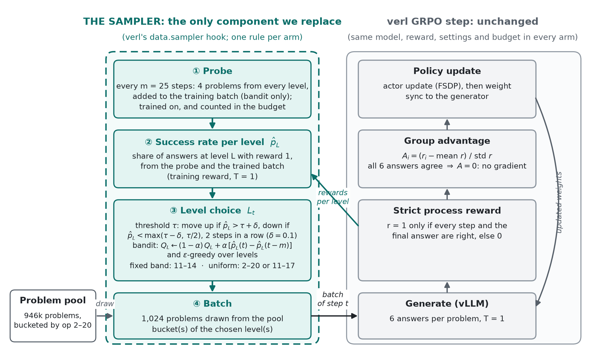

# Chasing the Edge: Adaptive Difficulty for GRPO

> Working draft in Markdown. Sections follow the course's required structure (Abstract, Problem, Related work,
> Methodology, Experimental evaluation, Preliminary results, overview figure). Conversion to the LaTeX template and
> trimming to 4–6 pages come after the prose edits.

**COMP550 progress report** · Eren Acar Basaran, Turan Berke Yakarer · draft of 2026-11-22, due Dec 6

*All numbers are means ± SD over training seeds (3 for τ=0.1, uniform, the op 11–17 control and the bandit; 2
for the fixed band and τ=0.3; 1 for τ=0.5). Paired tests are pooled over seeds with the problem as the unit
and are not corrected for multiple comparisons. Source tables: docs/results_seeds.md.*

## Abstract

Zhang, Neubig and Yue (2025) show that reinforcement learning gives a small language model genuinely new
reasoning ability only when it trains at its *edge of competence*, and they fix that edge at one band of
difficulty for the whole run. We replace the fixed band with samplers that choose the difficulty of every
batch as the model learns, keeping everything else identical. Of three adaptive objectives (maximising the
share of informative gradient, maximising measured learning speed, and maximising headroom), headroom wins
clearly. A threshold sampler that moves to the next level as soon as the model's success rate on the current one
exceeds 0.2 (τ=0.1)
newly solves 95 ± 1.7 of 204 hard problems the base model never solved, against 48 for the paper's fixed band.
On the three hardest levels, which it never trained on, it solves 27.7 ± 0.6 of 102, against 20.0 ± 1.0 for
uniform sampling over all levels (p = 0.002). A control that samples τ=0.1's range uniformly from the start
recovers 81% of that gain, so **training on the right range is most of the win, and the schedule adds a small
margin** (+8.7 problems, p = 0.017). τ=0.1 is adaptive mainly early: it climbs while
levels are learnable and stops at op 17, the first level whose success rate stays below its 0.2 move-up
trigger, for the last 46–55% of the run. Its main contribution is that it found that range without being told:
the paper's hand-picked band was too low. Two further findings correct our own proposal.
The sampler with the most informative gradient (τ=0.5, 40% of groups) learns nothing new, because a level's
success rate tops out near 0.5 under this setup and learning is fastest near 0.1–0.2. And an improvement-rate
bandit fails for a structural reason: the level it trains improves because it is trained, so its choice pays
for itself and it never moves on.

**Contributions.**

1. **A compute-matched comparison of three objectives for adaptive difficulty in GRPO**: gradient efficiency
   (threshold τ=0.5), learning speed (an improvement-rate bandit) and headroom (threshold τ=0.1), against the
   paper's fixed band and two uniform controls. Only the sampler differs between arms, and the rollouts the
   samplers spend measuring difficulty count against the same budget.
2. **Headroom wins, and most of its advantage is the range it finds.** τ=0.1 newly solves the most hard
   problems, including on levels it never trained on. A range-versus-schedule decomposition with a control
   trained on τ=0.1's range from step 0 attributes 64% of the gain over the fixed band to training on harder
   problems at all, 18% to the right range and 18% to the schedule.
3. **p ≈ 0.5 is the end of a level's learning curve, not its sweet spot.** Measured per-level learning curves
   are steepest at p ≈ 0.10–0.21 (op 13–15) and level off at 0.35–0.58, which explains why the arm with the most
   informative gradient learns nothing new and corrects the premise of our own proposal.
4. **A structural failure mode of learning-progress curricula under GRPO**: the trained level generates its
   own reward. An ablation with 2.5× faster probes rules out measurement lag as the main cause.
5. **A reusable pipeline**: four samplers that plug into verl's curriculum hook without modifying it, a
   simulated-model harness that caught an oscillation bug before any GPU time was spent, and 17 completed runs
   with every sampler decision logged.
6. **A stall law for threshold curricula**: each threshold arm climbs while the level it trains can reach its
   move-up trigger τ + δ and stops at the first level whose success rate stays below it. Ceilings measured in
   other arms predict all three final levels. It also says how adaptive τ=0.1 really is (the first half of the
   run), and it is the hypothesis for the January τ values.
7. **Success rate alone does not predict learning speed**: at the same p, harder levels learn 10–40× more
   slowly, which matters for any curriculum rule that targets a success rate.

## 1. Problem: background and question

Group Relative Policy Optimisation (GRPO) samples G completions per problem and computes each completion's
advantage relative to its group. If all G completions are right, or all are wrong, every advantage is zero
and the problem contributes no gradient. With per-problem success rate p, the expected fraction of
informative groups is 1 − pᴳ − (1 − p)ᴳ. With G = 6, this is under 6% at p = 0.01 and above 80% for
p between 0.3 and 0.7.

The paper trains a 100M-parameter model on synthetic arithmetic problems whose difficulty is the number of
operations (op 2–20), with a strict process-verified reward that requires every reasoning step and the final
answer to be correct. Its central finding is that RL produces genuinely new ability only on problems near the
model's edge, and it trains on a fixed band, op 11–14, chosen once.

The edge moves as the model learns: a band that is informative at step 0 becomes easy, and levels above it
become learnable. **Our question is whether a sampler that moves the training difficulty up as the model
learns creates more new ability
than the fixed band, or only more reliability on what the model can already do**, and which notion of "the
edge" a sampler should aim for.

**Why this is interesting.** Three reasons.

* **Compute.** In GRPO every all-right or all-wrong group is generated, scored and then contributes nothing.
  Where the difficulty sits decides how much of the rollout budget turns into gradient, and at step 0 the
  paper's own band gives an informative group only 1.5% of the time at op 13 and 0.02% at op 14 (§7).
* **New ability versus reliability.** Whether RL teaches a model anything new or only sharpens what it can
  already do is an open question (Yue et al., 2025; Zhang et al., 2025). If new ability appears only at the
  edge, then *how the training distribution follows the edge* is a direct lever on the answer, and the
  paper's controlled setting lets us count new ability problem by problem.
* **The paper asks for it.** The authors recommend re-evaluating the pool of edge-of-competence tasks
  periodically, so that "previously out-of-distribution tasks will drift into the solvability gap, creating a
  natural, self-paced curriculum" (Zhang et al., 2025, §3). They do not test it. Our samplers are that
  curriculum, and the comparison tells us which notion of the edge it should track.

## 2. Related work

**RL for reasoning and the question of new ability.** GRPO (Shao et al., 2024) replaces PPO's value function
with a group baseline and is the standard recipe for RL on reasoning models (DeepSeek-AI, 2025). Yue et al.
(2025) compare pass@k of base and RL-trained models and argue that RL mostly sharpens what the base model can
already do: at large k the base model catches up. Zhang et al. (2025) revisit the question in a fully
controlled synthetic setting (data from the GSM-Infinite generator; Zhou et al., 2025), and find that RL does
create new ability, but only when RL data sits at the model's edge of competence and pre-training has left
room for it. We use their model, data, reward and headline metric, and change only how the RL data is chosen
over time.

**Difficulty-aware data selection for RL on LLMs.** Several methods react to the zero-gradient problem. DAPO
(Yu et al., 2025) over-samples and discards groups whose rewards are all equal ("dynamic sampling"). Online
difficulty filtering keeps problems of intermediate measured accuracy for each batch (Bae et al., 2025), and
adaptive curricula move a target difficulty with the reward signal (Shi et al., 2025). These methods mostly aim
at gradient efficiency, i.e. at p near 0.5. We test that objective directly against a headroom objective, at
equal compute and with measurement rollouts charged to the budget, and find that in this setting it is the
wrong target (§6.4–6.5).

**Curriculum learning and learning progress.** Training from easy to hard goes back to Bengio et al. (2009);
self-paced learning lets the learner pick examples by its current loss (Kumar et al., 2010). Automatic
curriculum learning treats the choice of task as a non-stationary bandit whose reward is *learning progress*,
the recent change in performance on a task (Graves et al., 2017; Matiisen et al., 2020; survey: Portelas et
al., 2020), usually with ε-greedy or softmax selection (Sutton and Barto, 2018). Our bandit arm is a direct
instance. We find a failure mode that is specific to using it as a GRPO data sampler: the task it trains on is
the task that improves, so the progress signal rewards its own choice (§6.6).

**Infrastructure and evaluation.** Training runs in verl (Sheng et al., 2025) with vLLM generation (Kwon et
al., 2023). pass@k uses the unbiased estimator of Chen et al. (2021).

## 3. Methodology

We keep the paper's model, data, GRPO settings and reward. We change only which difficulty level each
training batch is drawn from, through verl's existing curriculum-sampler hook. Every run uses the same budget:
100 steps of 1,024 prompts × 6 rollouts on one A40 GPU (about 8 GPU-hours). Probe rollouts used by the
adaptive samplers to measure success rates count against the budget.

| arm | rule | objective |
|---|---|---|
| fixed band | uniform over op 11–14 | the paper's method |
| uniform | uniform over op 2–20 | control: "harder problems help at all" |
| **uniform op 11–17** | uniform over op 11–17 from step 0 | control: range without schedule (§6.3) |
| threshold τ=0.5 | one active level; move up when its success rate p stays above τ+δ for 2 steps, down when below τ−δ (δ = 0.1, lower bound clamped at τ/2) | gradient efficiency: stay where p ≈ 0.5 |
| threshold τ=0.3 | same, τ = 0.3 | intermediate |
| threshold τ=0.1 | same, τ = 0.1: move up when p > 0.2 | headroom: train where the model mostly fails |
| bandit | each level is an arm; reward = change in p between probes every m = 25 steps; ε-greedy (α = 0.3, ε = 0.1) | learning speed |

A simulated model (success logistic in skill minus level, skill rising over time) was used to test every
sampler before any GPU time was spent. It caught an oscillation in the threshold rule: adjacent levels
straddle any band, so the sampler ping-ponged. We added a memory that never moves into a neighbour freshly
measured on the wrong side.

**Figure 1. Overview.** The GRPO training step (right, grey) is verl's, unchanged and identical in every arm.
The sampler (left, dashed) is the only component we replace. ① On probe steps the batch includes a few
problems from every level (bandit only). ② The rewards of each step give a success rate per level. ③ The
arm's rule turns those success rates into the level(s) of the next batch. ④ The batch is drawn from the pool
bucket of each chosen level. (`eval/plot_overview.py`; vector version `results/overview.pdf`.)

### 3.1 Formal statement

**Training loop.** Let $\mathcal{L} = \{2, \dots, 20\}$ be the difficulty levels (number of operations) and
$\mathcal{D} = \bigcup_{L \in \mathcal{L}} \mathcal{D}_L$ the training pool, bucketed by level. At each step
$t = 0, \dots, T-1$ ($T = 100$) the sampler outputs levels $\ell_{t,1}, \dots, \ell_{t,B}$ ($B = 1024$), and
problem $x_{t,j}$ is drawn from $\mathcal{D}_{\ell_{t,j}}$ without replacement (a bucket is reshuffled when it is
used up). The policy $\pi_\theta$ samples $G = 6$ answers $y_{j,1}, \dots, y_{j,G}$ per problem at temperature 1,
each scored by the strict process reward $r_{j,i} \in \{0, 1\}$. GRPO's advantage is

$$A_{j,i} = \frac{r_{j,i} - \operatorname{mean}_k r_{j,k}}{\operatorname{std}_k r_{j,k} + \epsilon},$$

so problem $j$ contributes gradient only if $0 < \sum_i r_{j,i} < G$. For a problem with success probability
$p$ this happens with probability $1 - p^G - (1-p)^G$. After the update, the sampler receives the per-level
success rate of the step,

$$\hat{p}_L(t) = \frac{1}{n_L(t)} \sum_{j:\, \ell_{t,j} = L} \sum_{i=1}^{G} r_{j,i}, \qquad n_L(t) = G \cdot |\{j : \ell_{t,j} = L\}|,$$

computed with the training reward, and chooses the next step's levels. The arms differ only in this map from
$\{\hat{p}_L(s)\}_{s \le t}$ to $\ell_{t+1,\cdot}$. Every arm generates exactly $T \cdot B \cdot G = 614{,}400$
answers; probe problems are part of the $B$, so measurement is paid for out of the same budget.

**Non-adaptive arms.** Fixed band: $\ell_{t,j} \sim \mathrm{Unif}\{11, \dots, 14\}$. Uniform:
$\mathrm{Unif}\{2, \dots, 20\}$. Control: $\mathrm{Unif}\{11, \dots, 17\}$. All i.i.d. over $j$ and $t$.

**Threshold($\tau$).** One active level $L_t$, with $\ell_{t,j} = L_t$ for all $j$ and $L_0 = 11$. With
$\delta = 0.1$ the band is

$$h = \min(\tau + \delta,\ 1), \qquad l = \max(\tau - \delta,\ \tau / 2),$$

i.e. $[0.05, 0.2]$, $[0.2, 0.4]$ and $[0.4, 0.6]$ for $\tau = 0.1, 0.3, 0.5$ (the clamp $\tau/2$ makes the lower
bound reachable at $\tau = 0.1$). A measurement $\hat{p}(t) = \hat{p}_{L_t}(t)$ is pooled over steps until it rests
on at least 64 answers; at $B \cdot G = 6{,}144$ answers per step, every step is one measurement. Streak
counters

$$u_t = (u_{t-1} + 1)\,\mathbb{1}[\hat{p}(t) > h], \qquad d_t = (d_{t-1} + 1)\,\mathbb{1}[\hat{p}(t) < l]$$

give the move rule, with patience $k = 2$:

$$L_{t+1} = \begin{cases} L_t + 1 & \text{if } u_t \ge k \text{ and not } \mathrm{hard}(L_t + 1), \\ L_t - 1 & \text{if } d_t \ge k \text{ and not } \mathrm{easy}(L_t - 1), \\ L_t & \text{otherwise.} \end{cases}$$

Both counters reset after a move; a move refused by the memory resets its own counter. **Known-side memory** stores each level's last measurement
$M[L] = (\hat{p}, s)$ with its measurement index $s$: $\mathrm{hard}(L')$ holds if $L'$ was measured within the
last 50 measurements with $\hat{p} < l$, and $\mathrm{easy}(L')$ if it was measured with $\hat{p} > h$. Without it,
adjacent levels that straddle the band make the rule move back and forth every $k$ steps (the simulated model
showed 60+ reversals in 500 steps; with it, 0).

**Bandit.** Probe steps are $t \in \{0, m, 2m, \dots\}$ with $m = 25$: the batch then contains $k_p = 4$ problems
from every level (76 problems, 456 answers) and the rest from the policy below. Only probe steps update the
values: with $\hat{p}_L(t)$ computed from all answers at level $L$ in the probe step's batch,

$$r_L(t) = \hat{p}_L(t) - \hat{p}_L(t - m), \qquad Q_L \leftarrow (1 - \alpha)\,Q_L + \alpha\, r_L(t),$$

with $\alpha = 0.3$ and $Q_L = 0$ initially, so the first update is at $t = 25$. Each non-probe slot of every
batch draws its level independently:

$$\ell_{t,j} = \begin{cases} \text{a level uniform on } \mathcal{L} & \text{with probability } \varepsilon = 0.1, \\ \arg\max_L Q_L \ (\text{ties broken uniformly}) & \text{otherwise.} \end{cases}$$

The greedy level therefore receives $1 - \varepsilon + \varepsilon / |\mathcal{L}| \approx 90.5\%$ of the batch,
and levels 15–20 together receive at least the $\varepsilon$ floor $\varepsilon \cdot 6 / 19 = 3.16\%$.

**Evaluation.** Held-out test sets of 225 easy (op 2–10), 800 medium (op 11–14) and 204 hard (op 15–20)
problems, 128 samples each at T = 0.7, scored with the paper's evaluation criterion. pass@k uses the unbiased
estimator. **The headline metric is the paper's own: problems the base model never solved (0 of 128) that
the trained model solves at least once.** The base model solves none of the 204 hard problems, so on the hard
set every solved problem is new.

## 4. Experimental evaluation

The evaluation paragraph in §3 summarises the protocol. This section gives the datasets, metrics and statistics in
full.

**Datasets.** All data come from the paper's released synthetic dataset (`Interplay-LM-Reasoning/composition`,
built with the GSM-Infinite generator; Zhou et al., 2025). Each problem is a dependency graph of arithmetic
operations wrapped in a story; its level is its number of operations. The release has four splits per level:
`train/` (pre-training only, never used), `heldout/` (50,000 per level, the RL pool), `val/` (200 per level)
and `test/` (1,000 per level).

| set | source | per level | levels | total | use |
|---|---|---|---|---|---|
| RL training pool | `heldout/` | ≈ 49,800 | op 2–20 | 946,492 | every arm's training batches and the bandit's probes |
| tracking set | `val/` | 32 | op 2–20 | 608 | success rate per level every 10 steps, 8 answers at T = 1; measurement only, no sampler sees it |
| easy test set | `test/` | 25 | op 2–10 | 225 | evaluation |
| medium test set | `test/` | 200 | op 11–14 | 800 | evaluation |
| hard test set | `test/` | 34 | op 15–20 | 204 | evaluation (main result) |

Test problems are checked for (problem, question) collisions against `val/`, `heldout/` and duplicates
inside `test/`, and colliding problems are dropped before sampling, so the test sets are disjoint from
everything RL can see. Problems are keyed by a content hash because the dataset's `id` is not unique. Prompts
longer than 1,024 tokens are removed from the pool and the tracking set beforehand, so that verl's silent
length filter never changes what a sampler draws (`samplers/build_pool.py`; `data/testsets/manifest.json`).

**Protocol.** Every run is evaluated at its final checkpoint (step 100). For each test problem we draw $n = 128$
answers at $T = 0.7$ with vLLM (answers capped at 1,024 tokens) and score them with the paper's evaluation
criterion: every gold node of the dependency graph and the final answer must be right, extra nodes are
allowed. The training reward is stricter (extra nodes also give 0); the two agree to within 0.9 points at op
≤ 10 and exactly at op ≥ 11. The base model is evaluated once with the same protocol, and its per-problem
counts are saved before any RL.

**Metrics.** With $c$ correct answers out of $n$, the unbiased estimator (Chen et al., 2021) is

$$\text{pass@}k = 1 - \binom{n - c}{k} \Big/ \binom{n}{k}.$$

pass@1 measures reliability, pass@128 reachability. The headline metric is the number of problems that are
**newly solved**: never solved by the base model and solved at least once after training,

$$N_{\text{new}}(S) = \sum_{x \in S} \mathbb{1}[c_{\text{base}}(x) = 0]\ \mathbb{1}[c(x) > 0].$$

On the hard set $c_{\text{base}}(x) = 0$ for all 204 problems, so $N_{\text{new}}$ counts every solved problem. From
the training logs we also report the share of groups with a nonzero gradient, the levels each sampler chose
at every step, and success rates on the tracking set.

**Arms and seeds.** Seven arms (§3) at 100 steps each: 3 seeds for τ=0.1, uniform, the op 11–17 control and the
bandit; 2 for the fixed band and τ=0.3; 1 for τ=0.5 (it never leaves op 11, so more seeds buy nothing). 17
runs, 8.2 GPU-hours each on one A40. The seed (`data.seed`, passed on to the sampler) sets the order in which
each pool bucket is drawn and the sampler's own random choices.

**Statistics.** For arms A and B with seed sets $S_A$ and $S_B$, each problem gets a paired difference

$$d_x = \frac{1}{|S_A|} \sum_{s \in S_A} \mathbb{1}[x \text{ newly solved by } A_s] - \frac{1}{|S_B|} \sum_{s \in S_B} \mathbb{1}[x \text{ newly solved by } B_s].$$

We report $\sum_x d_x$ (the difference in newly solved problems per seed) with a 95% bootstrap CI over problems
(10,000 resamples), and an exact two-sided sign test over the problems with $d_x \ne 0$. Within a single seed
pair we use McNemar's test. For pass@1 on the easy and medium sets we use the same pairing on per-problem
pass@1 and also count the cross-seed pairs in which A is below B. Means are ± SD over seeds. Nothing is
corrected for multiple comparisons.

## 5. Preliminary results I: baseline performance (reproduction)

The pretrained checkpoint reproduces the paper's base-model numbers: 31 of 32 comparisons are within six
points, for example op 11–14 pass@128 41.8 against about 42 in the paper's Figure 9. The 1024-token answer
limit is not binding: correct solutions stay under 440 tokens.

Our fixed-band run matches the paper's released RL checkpoint within one point on every test set: medium
pass@1 49.2 vs 49.4, hard pass@128 23.5 vs 23.5, and 48 of 204 hard problems newly solved for both. The
released checkpoint was probably trained with an answer-only reward rather than the strict one we use; the
close match suggests this matters little at 100 steps. All later comparisons are against this baseline.

**Baseline performance** (pass@1 / pass@128, T = 0.7, n = 128, evaluation criterion; our fixed band is the mean
of 2 seeds; paper values read off its Figure 3, ± 2 points):

| set | base model | **fixed band, ours** | released RL checkpoint | paper, Fig. 3 | newly solved: ours / released |
|---|---|---|---|---|---|
| easy, op 2–10 (225) | 85.5 / 98.7 | **85.4 / 98.7** | 85.2 / 98.7 | 87.0 / 99.0 | 0 / 0 of 3 |
| medium, op 11–14 (800) | 17.5 / 38.4 | **49.2 / 84.3** | 49.4 / 83.9 | 51.0 / 85.5 | 369 / 368 of 493 |
| hard, op 15–20 (204) | 0 / 0 | **9.9 / 23.5** | 10.8 / 23.5 | 9.5 / 26.0 | 48 / 48 of 204 |

("of N" = problems the base model never solved in that set.) The fixed band's two seeds agree to within 0.9
points everywhere and newly solve exactly 48 hard problems each.

## 6. Preliminary results II: adaptive samplers

### 6.1 Main results

| arm | seeds | hard pass@128 | hard newly solved (of 204) | op 18–20 newly solved (of 102) | groups with nonzero gradient |
|---|---|---|---|---|---|
| **threshold τ=0.1** | 3 | **46.6 ± 0.8** | **95.0 ± 1.7** | **27.7 ± 0.6** | 24.7% |
| uniform op 11–17 (control) | 3 | 42.3 ± 1.0 | 86.3 ± 2.1 | 24.0 ± 2.0 | 28.6% |
| uniform op 2–20 | 3 | 38.2 ± 0.5 | 78.0 ± 1.0 | 20.0 ± 1.0 | 18.8% |
| fixed band (paper) | 2 | 23.5 ± 0.0 | 48.0 ± 0.0 | 6.0 ± 0.0 | 35.4% |
| threshold τ=0.3 | 2 | 23.8 ± 1.7 | 48.5 ± 3.5 | 4.0 ± 1.4 | 34.0% |
| bandit | 3 | 19.9 ± 1.7 | 40.7 ± 3.5 | 3.3 ± 1.5 | 29.1% |
| threshold τ=0.5 | 1 | 0.0 | 0 | 0 | 40.1% |

The samplers behaved the same way in every seed. τ=0.1 climbed from op 11 to op 14 by step 8, reached op 15
at step 16, op 16 at step 22–25 and op 17 at step 45–54, and then stayed at op 17 for the remaining 46–55
steps, where its success rate hovered around 0.17, below the 0.2 move-up trigger (§6.8). τ=0.3 settled on op 14 by step 25. τ=0.5 never left op 11.
The bandit settled on op 12–14.

### 6.2 Headroom: levels τ=0.1 never trained on

Neither τ=0.1 nor the fixed band ever trained on op 18–20. Uniform sampling did: 16% of its prompts came from
those levels. Yet τ=0.1 newly solves 27.7 ± 0.6 of those 102 problems and uniform 20.0 ± 1.0. Paired by
problem across three seeds each, τ=0.1 solves 15 problems more often than uniform and uniform 2 more often
than τ=0.1 (sign test p = 0.002; +7.7 problems per seed, 95% CI +3.7 to +12.3). The direction is the same in
each seed separately.

The reason is visible in the gradient. 97% of uniform's groups at op 18–20 had zero gradient: at the model's
current skill, every rollout there fails, and exposure to a level teaches nothing when it is never solved.
τ=0.1 instead spent 84% of its groups on op 15–17 at success rates of 0.10–0.21 (op 15–16 while it
climbed, op 17 for the second half of the run), with 20,642
informative groups there per run (uniform: 2,300; the fixed band: 0), and the skill it built carried two to
three levels beyond anything it trained on.

### 6.3 Range or schedule?

τ=0.1 differs from the fixed band in two ways: it trains on a different range of levels (op 11–17 instead of
op 11–14), and it visits them in order, moving up only when the current level reaches p > 0.2. To separate
the two, we trained a control that samples uniformly over op 11–17 from the first step: the same range,
without the schedule. We chose that range by looking at where τ=0.1 went.

**The range is most of the win.** The control newly solves 86.3 ± 2.1 hard problems and 24.0 ± 2.0 on op
18–20: 81% and 83% of τ=0.1's gain over the fixed band. Splitting τ=0.1's gain of 47 hard problems over the
fixed band into steps: training on harder problems at all (uniform over op 2–20) accounts for 30 (64%),
restricting to the right range adds 8.3 (18%), and the schedule adds 8.7 (18%). The split on op 18–20 is
nearly identical (65%, 18%, 17%).

**The schedule adds a small, real margin.** On the whole hard set, τ=0.1 beats the control on 17 problems and
loses on 5 (p = 0.017; +8.7 per seed, 95% CI +3.3 to +14.3), and it is ahead in every seed. On op 18–20 alone
the gap is +3.7 problems per seed (8 vs 2, p = 0.11), which is not significant. Per level, the margin sits at
op 15 (29.0 vs 26.3) and op 16 (20.0 vs 17.7), the levels τ=0.1 trained intensively while it was still
climbing. At op 17, where both arms trained heavily, they are equal (18.3 each).

**What the adaptive sampler contributes is the range itself.** The paper's band gets 48 hard problems. The
range τ=0.1 found gets 86 when sampled uniformly and 95 with τ=0.1's schedule. op 11–17 is the paper's band
plus three levels at which the base model has a success rate of exactly zero; nothing in the base model's
measurements points to them, and we would not have tried this range without τ=0.1. A threshold sampler
is a way to find a good range in one run instead of a sweep over ranges. It does not follow the edge for the
whole run: it climbs while levels are learnable, stops at the first level it cannot push past its trigger
(§6.8), and the levels it passed through are the range. We consider this the
main positive result of the project, and the schedule's margin a secondary one.

### 6.4 More informative gradient did not mean more learning

The τ sweep ranks the arms in the reverse order of their gradient efficiency. τ=0.5 keeps 40.1% of its groups
informative, the highest of any arm, and newly solves 0 hard problems. τ=0.1 keeps 24.7% informative and
newly solves 95. τ=0.3 (34.0%) and the fixed band (35.4%) sit in between on both counts in the opposite
order. τ=0.1 did not receive more gradient than the other arms; it received gradient in a different place.

τ=0.5 is also a fixed point of its own rule. Its success rate at op 11 hovers at 0.55–0.63 and never stays
above the 0.6 move-up bound for two steps, so it trains on op 11 for the whole run.

### 6.5 Why τ=0.1: where a level learns fastest

Per-step success rates of each level during training trace an S-shaped curve. Measured on every level that
starts at p ≈ 0 (fixed band and uniform runs, training reward, T = 1.0), the steepest rise is at
**p ≈ 0.10–0.21**, at 30–50% of the level's final value, and the curve flattens at a ceiling of p ≈ 0.35–0.58
(op 11: 0.57). Improvement at p ≈ 0 is also near zero.

This explains both ends of the τ sweep. τ=0.1's target band, [0.05, 0.2], contains the steepest point
measured for op 13–15, and on those levels τ=0.1 trained during the fastest improvement and moved on. The
steepness does not carry over to harder levels: at op 16–17 τ=0.1 trained at p ≈ 0.11–0.20, but p rose only
0.01–0.05 per 10 steps there, against 0.31–0.43 at op 13–14 (§6.8). τ=0.5's band,
[0.4, 0.6], is the ceiling: it maximises informative groups by sitting where nothing is left to learn, and
because op 11's ceiling (0.57) is below the move-up bound (0.6), it never leaves. Our proposal assumed that
p = 0.5 was the sweet spot because it maximises the informative fraction. Under this reward and temperature
p ≈ 0.5 is the end of a level's learning curve, not its midpoint, and the premise was wrong. τ=0.1 is the
best of the three values we ran and the one the curve predicts. Values between 0.1 and 0.3 are untested.

### 6.6 The bandit: the level it trains generates its own reward

The bandit is the weakest trained arm (40.7 ± 3.5 hard problems, below the fixed band's 48) in all three
seeds. Its reward is the improvement in a level's success rate between probes, and the level it trains is the
level that improves, *because* it is trained. The greedy choice therefore pays for itself: it keeps 90% of
every batch and stays on op 12–14 for the whole run. op 15 became learnable anyway through spill-over (probe
success rate 0.31 by step 50 in seed 0) and reached second place in value, but under an argmax second place
gets nothing. After the first value update, op 15 and above were sampled only by ε-exploration, at exactly
the ε floor of 3.2% of prompts, in all three seeds.

A faster probe interval does not help. With probes every 10 steps instead of 25, the bandit locked on
sooner, onto an even easier level (op 12), and op 15+ again received only the ε floor. Measurement lag
therefore makes the problem worse but is not its cause; self-reward is. Probe noise (standard error about
0.09 against value margins of about 0.01) makes *which* of op 12–15 wins partly chance, but the trained
level's head start is not. We read this as a structural limitation of improvement-rate curricula for GRPO,
not a tuning problem.

### 6.7 Costs: reliability on easier problems

τ=0.1's new ability on hard problems comes with a small, consistent loss of reliability on easier ones.
Its easy pass@1 is 83.9 ± 0.2, against 85.3 ± 0.1 for the control, 85.4 for the fixed band and 85.5 for the
base model; its medium pass@1 is 46.7 ± 0.4, against 49.1 for the control and 49.2 for the fixed band. This
is not seed noise. The easy gap is about ten times the seed standard deviation, every cross-seed pair (6 of 6
against the fixed band, 9 of 9 against the control) has τ=0.1 lower, and paired by problem the deficit
against the base model is −1.6 points (95% CI −3.0 to −0.3). It is spread over op 2–10 rather than
concentrated in a few problems.

Reachability is unaffected. Easy pass@128 is 98.5 for τ=0.1, uniform and the control, each loses on average
0.3 easy problems the base model could solve, and τ=0.1's medium pass@128 equals the control's (85.0 vs 84.9).
τ=0.1 is less reliable on easier problems, not less able. The medium gap follows from where it trained: it
left op 11–14 by step 8 and spent only 16% of its groups there, against 57% for the control. The easy gap
does not follow from that alone, since the control also never trains on op 2–10 and stays at the base
model's level. A plausible but untested explanation is that from step 25 onward every τ=0.1 batch is at op 16
or 17 with a success rate below 0.2, so most of its gradient pushes away from failing solutions.

The practical reading: if the right range is known, sampling it uniformly gets 81% of the gain at no
reliability cost; τ=0.1 finds the range and adds a small margin on the hardest problems at a cost of about
1.5 points of easy and 2.5 points of medium pass@1.

### 6.8 How adaptive is τ=0.1? The stall law

τ=0.1 does not track the edge for the whole run. From the sampler logs of all six threshold runs
(`eval/stall_law.py`):

| arm (seeds) | move-up trigger h = τ + δ | stopped at | reached at step | share of the run there | batch p there, last 20 steps | slope, last 30 steps (per 10 steps) |
|---|---|---|---|---|---|---|
| τ=0.1 (3) | 0.2 | op 17 | 45–54 | 46–55% | 0.174–0.178 | +0.006 to +0.009 |
| τ=0.3 (2) | 0.4 | op 14 | 23–25 | 75–77% | 0.369–0.373 | +0.002 to +0.004 |
| τ=0.5 (1) | 0.6 | op 11 | 0 | 100% | 0.588 | +0.005 |

**Stall law: a threshold arm climbs while the level it trains can reach its trigger and stops at the first
level whose success rate stays below it.** No final level ever had the two consecutive measurements above h
that a move needs. Ceilings measured independently in the fixed band and the control (op 11 0.57, op 12 0.54,
op 13 0.44, op 14 0.35, op 15 0.31, op 16 0.21, op 17 0.15) predict all three stopping levels. For τ=0.3 and
τ=0.5 the final level is flat, a true plateau below the trigger. For τ=0.1 it is not demonstrably a plateau:
op 17 was still rising by about 0.01 per 10 steps at step 100, so a ceiling just under 0.2 and a climb too
slow for the run are indistinguishable here.

The climb slowed level by level. τ=0.1's success rate rose by 0.31–0.43 per 10 steps at op 13–14, 0.12–0.17
at op 15, 0.03–0.05 at op 16 and about 0.01 at op 17. op 11 → 15 took 16 steps, op 16 took 23–29, and op 17
the remaining 46–55. The honest description is: **τ=0.1 climbs while levels are learnable, stops at the first
level whose success rate stays below its trigger, and its main contribution is the range it passed through on
the way** (§6.3). The stall law is the hypothesis for the January τ = 0.15 and 0.2 runs (§9).

When the gain over the control arose is not settled yet. In the tracking set (32 problems per level, T = 1),
τ=0.1's lead on op 15–16 opens while it climbs (steps 20–50) and closes by step 80–100. Its lead on op 17 grows
during the stall. On op 18–20 it leads from step 30 on by a small, roughly steady margin.

The step-25/50/75 checkpoints on the hard set (newly solved, mean of 3 seeds, pooled paired test) answer it
with the headline metric. τ=0.1 led by +21 problems at step 25 while climbing (54 vs 33, p < 10⁻⁶). The control
caught up by step 50 (79 vs 75, p = 0.11; op 18–20 tied, 16.7 vs 16.3). The lead re-formed during the stall at op
17: +8 at step 75 (op 18–20: +6, p = 0.023) and +8.7 at step 100. **The final advantage over the control comes
from concentrated training on op 17 late in the run, not from the climb**, whose lead had disappeared by step
50. That late concentration is not itself adaptive.

**The climb buys compute-efficiency, not final quality.** At step 25, a quarter of the training compute (2.0
GPU-hours against the fixed band's 7.8 for 100 steps), τ=0.1 has already newly solved 54 hard problems. The
paper's fixed band reaches 48 after all 100 steps. Paired by problem, τ=0.1 at step 25 is +6 problems ahead of the
fixed band's final result (95% CI +0.2 to +12.0; sign test p = 0.11, 17 vs 8 problems; op 18–20 tied): it matches
the paper's final result and probably exceeds it. The control at step 25 has only 33. It spent 43% of its first
25 steps on op 15–17 while those levels were still at p ≈ 0, where only about 2% of groups had a gradient (183–265
informative groups per run, against τ=0.1's 2,167–2,404). The control catches up by step 50, so the climb's
advantage is speed. Final quality comes mostly from the range (§6.3). These five comparisons are not corrected for
multiple comparisons, and the fixed band's own step-25 checkpoint was not evaluated.

### 6.9 Success rate alone does not predict learning speed

At the same success rate, harder levels learn more slowly. τ=0.1 trained op 13 to op 17 in the same band of
success rates, p ≈ 0.10–0.21, which is where op 13–15 rise fastest. Yet the rise per 10 steps fell from
0.31–0.43 at op 13–14 to 0.12–0.17 at op 15, 0.03–0.05 at op 16 and about 0.01 at op 17: 10–40× slower at the
same p, two or three levels higher. The steepest-point estimate of §6.5 holds for the levels it was measured
on and does not transfer upward.

This bears on any curriculum rule that targets a success rate, including our threshold rule and the
difficulty filters in §2 that keep problems of intermediate accuracy. Such a rule assumes that a given p
means a given amount of learning. Here a target p chooses the level, but how much that level teaches also
depends on the level itself. The same effect explains the stall in §6.8: as levels got harder, pushing p from
about 0.1 to the trigger took longer, from a few steps at op 13–14 to more than the remaining run at op 17.

## 7. Correcting our own motivation

Our proposal motivated the project with a step-0 measurement: in the base model, op 13 and op 14 give an
informative group 1.5% and 0.02% of the time, so "half the paper's band is dead weight". That is a snapshot
and it does not last. In the fixed-band run (seed 0), training on op 11–12 generalises upward: op 13 reaches 37% and
op 14 29% informative groups by step 20. After the first 15 steps the band is not wasteful. Its real
limitation is the other end: it never moves past op 14 while op 15–17 become learnable (op 15 goes from never
solved to 27% informative groups by step 50 without being trained on). That is the gap τ=0.1 closes
in its first 16–25 steps (op 15 at step 16, op 16 at 22–25), and §6.3 shows that closing it is most of what
matters.

## 8. Limitations

* **100 steps.** This is half of the paper's run length. The fixed band might catch up with more steps, or the
  gap might widen; we have not tested it.
* **Seeds.** Three seeds for the main arms, two for the fixed band and τ=0.3, one for τ=0.5. The fixed band's
  two seeds agree exactly on the hard set (48 and 48), and τ=0.5's result (no movement, nothing learned) is a
  property of its rule, so we do not expect more seeds to change those conclusions.
* **The control's range is chosen in hindsight**, from τ=0.1's own trajectory. That is the point of the
  control, but it means the "81%" is an upper bound on what a range chosen in advance would achieve.
* **Multiple comparisons.** The tests are not corrected. The τ=0.1 vs uniform result (p = 0.002) survives any
  reasonable correction; τ=0.1 vs the control on the whole hard set (p = 0.017) is borderline under one.
* **One τ grid.** We ran τ ∈ {0.1, 0.3, 0.5}. The learning-curve analysis predicts a peak between 0.1 and 0.2,
  and the stall law (§6.8) predicts that a higher trigger stops at a lower level; we have not tested values
  there.
* **Adaptive mainly early.** τ=0.1 changes level only in its first 45–54 steps, and τ=0.3 in its first
  23–25; both then train one level to the end. Whether τ=0.1's stall at op 17 is a ceiling or a climb too
  slow for 100 steps is open (§6.8).
* **Success rate is not learning speed.** Our rules, and the S-curve analysis behind τ=0.1, read the
  success rate only. At the same p, op 16–17 learned 10–40× more slowly than op 13–14 (§6.9), so a target
  success rate does not fix the learning rate, and the steepest-point estimate does not transfer to harder
  levels.
* **One model and one task family.** All results are for the paper's 100M-parameter model on synthetic
  arithmetic graphs.

## 9. Plan for the final report (January)

1. **τ = 0.15 and τ = 0.2, as a test of the stall law (§6.8).** Hypothesis: the trigger h = τ + δ, not τ, sets
   the final level. We use **δ = 0.1**, so the triggers are 0.25 and 0.30, genuinely different from τ=0.1's
   0.20 (bands [0.075, 0.25] and [0.10, 0.30]). Ceilings measured in other arms predict that τ = 0.15 stops at
   op 16 and τ = 0.2 at op 15–16. Both would then train a narrower range than τ=0.1 and, if the range drives
   the gain, newly solve fewer hard problems. The law is refuted if either climbs past its predicted level.
   About 38 GPU-hours for two seeds each.
2. **Range-finding as a method.** Run τ=0.1 for a short burn-in, then train uniformly on the range it found.
   If this matches τ=0.1, it combines the range-finding with the control's lack of reliability cost.
3. **200-step runs** of τ=0.1, the control and the fixed band. Prediction: if op 17 keeps rising at its
   measured ≈ 0.01 per 10 steps, τ=0.1 crosses 0.2 and moves to op 18 around step 125; if op 17 has a
   ceiling below 0.2, it stays.
4. **Bandit fixes**, three seeds each (about 25 GPU-hours per fix): softmax selection instead of argmax,
   optimistic initialisation, and, the one that targets the mechanism, a reward that excludes the improvement
   an arm receives from its own training.
5. **Reliability cost.** Test whether keeping a small share of op 11–14 in τ=0.1's batches removes the easy
   and medium cost without losing the hard-set gain.
6. **Learning speed at equal success rate.** Measure the rise per step against p for every level from the
   existing logs and the January runs. If the slowdown with level holds, test a rule that also reads the
   measured rise (without the bandit's self-reward, item 4), e.g. move up when the current level's rise has
   flattened rather than when p crosses a fixed trigger.
7. **Per-problem selection** within a level: problems are mostly always or never solved, so choosing problems
   by their own success rate could raise the informative share well above 40%.

## 10. Engineering and compute

verl runs unmodified; the samplers plug into its curriculum-sampler hook and log their choice, success-rate
estimates and internal state every step. Training, checkpoint conversion, evaluation and analysis run as
chained SLURM jobs. About four days of wall-clock time and 48 GPU-hours were lost to training jobs that hung
silently at startup; the cause was two jobs on the same node colliding on Ray's default ports and temporary
directory, fixed with a private Ray head and port range per job. Since then every job carries a watchdog that
cancels it if its step counter or log has not advanced for 30 minutes, and logs why. The 17 completed
100-step runs took 139 GPU-hours (8.2 per run on one A40); the project total including evaluation, the
bandit ablation, two cancelled runs and the hang is about 220 GPU-hours.

## References

Sanghwan Bae et al. 2025. Online difficulty filtering for reasoning oriented reinforcement learning.
arXiv:2504.03380. *(Verify against the proposal's bibliography.)*

Yoshua Bengio, Jérôme Louradour, Ronan Collobert, and Jason Weston. 2009. Curriculum learning. In *ICML*.

Mark Chen, Jerry Tworek, Heewoo Jun, Qiming Yuan, et al. 2021. Evaluating large language models trained on
code. arXiv:2107.03374.

DeepSeek-AI. 2025. DeepSeek-R1: Incentivizing reasoning capability in LLMs via reinforcement learning.
arXiv:2501.12948.

Alex Graves, Marc G. Bellemare, Jacob Menick, Rémi Munos, and Koray Kavukcuoglu. 2017. Automated curriculum
learning for neural networks. In *ICML*.

M. Pawan Kumar, Benjamin Packer, and Daphne Koller. 2010. Self-paced learning for latent variable models. In
*NeurIPS*.

Woosuk Kwon, Zhuohan Li, Siyuan Zhuang, Ying Sheng, Lianmin Zheng, Cody Hao Yu, Joseph E. Gonzalez, Hao Zhang,
and Ion Stoica. 2023. Efficient memory management for large language model serving with PagedAttention. In
*SOSP*.

Tambet Matiisen, Avital Oliver, Taco Cohen, and John Schulman. 2020. Teacher-student curriculum learning.
*IEEE Transactions on Neural Networks and Learning Systems*, 31(9).

Rémy Portelas, Cédric Colas, Lilian Weng, Katja Hofmann, and Pierre-Yves Oudeyer. 2020. Automatic curriculum
learning for deep RL: A short survey. In *IJCAI*.

Zhihong Shao, Peiyi Wang, Qihao Zhu, Runxin Xu, Junxiao Song, Xiao Bi, Haowei Zhang, Mingchuan Zhang, Y. K. Li,
Y. Wu, and Daya Guo. 2024. DeepSeekMath: Pushing the limits of mathematical reasoning in open language
models. arXiv:2402.03300.

Guangming Sheng, Chi Zhang, Zilingfeng Ye, Xibin Wu, Wang Zhang, Ru Zhang, Yanghua Peng, Haibin Lin, and Chuan
Wu. 2025. HybridFlow: A flexible and efficient RLHF framework. In *EuroSys*.

Taiwei Shi et al. 2025. Efficient reinforcement finetuning via adaptive curriculum learning. arXiv:2504.05520.
*(Verify against the proposal's bibliography.)*

Richard S. Sutton and Andrew G. Barto. 2018. *Reinforcement Learning: An Introduction*, 2nd edition. MIT Press.

Qiying Yu et al. 2025. DAPO: An open-source LLM reinforcement learning system at scale. arXiv:2503.14476.

Yang Yue, Zhiqi Chen, Rui Lu, Andrew Zhao, Zhaokai Wang, Yang Yue, Shiji Song, and Gao Huang. 2025. Does
reinforcement learning really incentivize reasoning capacity in LLMs beyond the base model? arXiv:2504.13837.

Charlie Zhang, Graham Neubig, and Xiang Yue. 2025. On the interplay of pre-training, mid-training, and RL on
reasoning language models. arXiv:2512.07783.

Yang Zhou, Hongyi Liu, Zhuoming Chen, Yuandong Tian, and Beidi Chen. 2025. GSM-Infinite: How do your LLMs
behave over infinitely increasing context length and reasoning complexity? arXiv:2502.05252.
