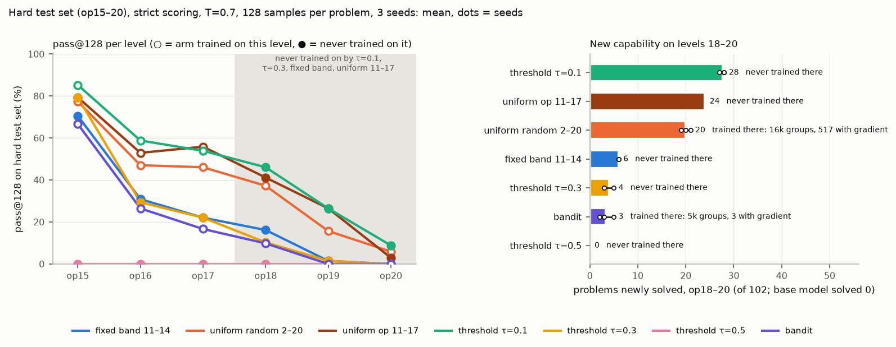

# First results: five samplers, seed 0 (2026-11-20)

**ONE SEED PER ARM. Every number in this document is seed 0 only.** Seeds 1 and 2 and the Bandit are running;
`eval/aggregate_seeds.py` turns them into mean ± spread and pooled paired tests as they land.

Every arm uses the identical config (`configs/rl_base.yaml`): 100 GRPO steps, 1024 prompts × 6 rollouts per
step, strict process reward, 1 A40. Only `data.sampler` differs. Evaluation uses the paper's protocol: T=0.7,
n=128, strict eval criterion. Test sets: easy op2–10 (225), medium op11–14 (800), hard op15–20 (204).

**Why adaptive sampling at all.** The edge moves during training. In the fixed-band baseline, op15 goes from
p = 0 to 0.25 and op16 from 0 to 0.13 within 100 steps (tracking set). The band never moves past op14, so it
never trains where the model has just become able to learn. Section 4 has the measurements.

## 1. Headline: op18–20, the levels τ=0.1 never trained on

**Figure 1** (`results/hard_by_level.png`, data `results/hard_by_level.csv`). Left: pass@128 on each hard level.
Hollow marker = the arm trained on that level, filled = it never did. Right: problems newly solved on op18–20,
with what each arm spent there.

Threshold τ=0.1 climbed to op17 and stopped, so **op18–20 are levels it never trained on**. Uniform random
trained on all of 2–20, **including 18–20**. τ=0.1 still wins there:

| arm (seed 0) | trained at op18–20? groups / with nonzero gradient | p@1 | **p@128** | **newly solved** (of 102) |
|---|---|---|---|---|
| **threshold τ=0.1** | **never** (0 / 0) | **10.6** | **26.5** | **27** |
| uniform random | yes (16,005 / 487) | 7.1 | 18.6 | 19 |
| fixed band | never (0 / 0) | 1.7 | 5.9 | 6 |
| released RL (paper) | never | 1.4 | 4.9 | 5 |
| threshold τ=0.3 | never (0 / 0) | 1.8 | 4.9 | 5 |
| threshold τ=0.5 | never (0 / 0) | 0 | 0 | 0 |

The base model solved 0 of these 102 problems in 128 tries.

**The mechanism: uniform's exposure to op18–20 was almost all zero-gradient.** Uniform drew 16% of its prompts
from op18–20, but **97% of those groups had zero gradient** (487 of 16,005 informative). At the model's skill
those groups are all-wrong: tracking p at op18 is still 0.04 at step 100. Seeing a level does not teach it if
every rollout fails. τ=0.1 spent its budget on op15–17 while those were at the edge (batch p ≈ 0.18, 25% of
groups informative). That skill carried two to three levels further than the training distribution reached.

* Per level (pass@128, τ=0.1 / uniform / fixed): op15 85 / 76 / 71, op16 59 / 50 / 32, op17 53 / 44 / 21,
  op18 47 / 38 / 15, op19 26 / 15 / 3, op20 6 / 3 / 0.
* Paired by problem on op18–20, **within seed 0 only**: τ=0.1 newly solves 9 problems uniform does not, and
  uniform 1 that τ=0.1 does not (exact McNemar p = 0.02). Against the fixed band: 22 vs 1. These tests do
  not include seed-to-seed variance. Do not quote them until seeds aggregate (`results/seeds_paired_tests.csv`,
  pooled rows).

### Did τ=0.1 just spend more of its compute on informative groups? No.

Share of **all** GRPO groups with nonzero gradient, pooled over the whole run (102,400 groups per arm, seed 0;
`results/seeds_gradient_budget.csv`), and where those informative groups were:

| arm | informative share, all groups | informative groups op11–14 | **op15–17** | **op18–20** | op18–20 newly solved |
|---|---|---|---|---|---|
| threshold τ=0.5 | **40.1%** | 41,071 | 0 | 0 | 0 |
| fixed band | 35.4% | 36,257 | 0 | 0 | 6 |
| threshold τ=0.3 | 33.9% | 34,752 | 0 | 0 | 5 |
| threshold τ=0.1 | 25.0% | 4,868 | **20,739** | 0 | **27** |
| uniform random | 18.8% | 7,503 | 2,296 | 487 | 19 |

(uniform also had 8,984 informative groups at op2–10.)

τ=0.1 had a *lower* informative share than the fixed band, τ=0.3 and τ=0.5. The total amount of gradient
signal does not explain the result. **Where the signal is** does. The op18–20 ranking follows the number of
informative groups beyond op14: τ=0.1 20,739, uniform 2,783, every other arm 0. Among the arms with none,
the ranking follows how high they trained (fixed band and τ=0.3 at op11–14: 5–6; τ=0.5 at op11 only: 0).

## 2. How much of the gain is "harder problems at all", and how much is adaptive timing

| arm | levels trained on | hard pass@128 | gain over fixed band | hard newly solved (of 204) |
|---|---|---|---|---|
| fixed band (baseline) | 11–14 | 23.5 | – | 48 |
| uniform random | 2–20 | 37.7 | +14.2 | 77 |
| threshold τ=0.1 | 11 → 17 | 46.1 | +22.6 | 94 |

Over the whole hard set, most of the improvement over the fixed band comes from **training on harder problems
at all**. Uniform random, which spends the budget evenly over every level, already gets **63% of τ=0.1's gain**
(+14.2 of +22.6pp pass@128; 29 of 46 extra newly-solved problems). **Adaptive timing is the smaller remaining
margin**: +8.4pp and 17 more problems for τ=0.1 over uniform. Section 1 is where that margin sits: on the
levels beyond τ=0.1's training range, which no informative gradient from uniform reached either.

Full table:

| arm | levels trained on | easy p@1 | medium p@1 / p@128 | hard p@1 / p@128 | hard newly solved |
|---|---|---|---|---|---|
| base model | – | 85.5 | 17.5 / 38.4 | 0 / 0 | – |
| released RL (paper) | 11–14 | 85.2 | 49.4 / 83.9 | 10.8 / 23.5 | 48 |
| fixed band | 11–14 | 85.5 | 49.2 / 84.8 | 10.2 / 23.5 | 48 |
| uniform random | 2–20 | 86.6 | 47.3 / 82.9 | 16.3 / 37.7 | 77 |
| threshold τ=0.1 | 11 → 17 | 84.0 | 46.9 / 84.8 | 22.9 / 46.1 | 94 |
| threshold τ=0.3 | 11 → 14 | 84.7 | 49.3 / 85.5 | 11.4 / 25.0 | 51 |
| threshold τ=0.5 | 11 only | 85.4 | 33.2 / 58.9 | 0 / 0 | 0 |

## 3. The τ sweep

| arm | path of the active level | mean p in batch | informative groups | hard newly solved |
|---|---|---|---|---|
| τ=0.1 | 11 →12 (step 1) →13 (3) →14 (7) →15 (15) →16 (22) →17 (51) | 0.18 | 25% | 94 |
| τ=0.3 | 11 →12 (1) →13 (4) →14 (24), then stays | 0.35 | 34% | 51 |
| τ=0.5 | 11 throughout | 0.57 | 40% | 0 |

* **Headroom beats gradient throughput.** The ranking is the exact reverse of the informative-group share.
  τ=0.5 has the most useful groups and learns nothing beyond op14. τ=0.1 has the fewest and learns the most.
* **τ=0.5 never moves.** The model's p at op11 sits at 0.55–0.63, never above τ+δ = 0.6 for 2 steps in a
  row. A target at the model's own success rate is a fixed point of the rule (δ = 0.1, patience 2).
* **τ=0.3 picked the paper's band on its own.** It reached op14 by step 24 and stayed there, matching the fixed
  band (51 vs 48 newly solved).

`results/sampler_levels.png` shows the level each arm chose, plotted over the measured success rate of every level.

### Why τ=0.1, and why τ=0.5 never moved: the learning curve of a level

`results/scurve.png` (`eval/scurve.py`; fixed band s0–s1, uniform s0–s1; details in docs/bandit_analysis.md §6).
A level's success rate under training rises in an S:

| | measured |
|---|---|
| where a level improves fastest | **p ≈ 0.10–0.21** (op 13: 0.19 / 0.21, op 14: 0.11 / 0.11, op 15: 0.10 / 0.12) |
| where it levels off (training reward, T = 1.0, 100 steps) | **p ≈ 0.35–0.58** (op 11 0.57, op 12 0.54, op 13 0.45, op 14 0.35) |
| improvement at p ≈ 0 | ≈ 0 (+0.0006 per 10 steps) |

* **τ=0.1 is a principled choice, not a lucky one.** Its target band [0.05, 0.2] contains the measured
  peak of the learning curve. It is the best of the three τ we ran, and the curve predicts that it should be.
  τ between 0.1 and 0.3 was not run.
* **τ=0.5 targets the ceiling, not the half-solved midpoint.** At T = 1.0, levels plateau around 0.35–0.58,
  so p ≈ 0.5 is where a level stops improving. That is also why τ=0.5 never moved: op 11 levels off at
  ≈ 0.57, below its move-up bound of 0.6.
* **Correction to our own brief.** The project brief (CLAUDE.md) framed τ as "p = 0.5 maximises gradient
  throughput vs low p maximises headroom". The first half is true as arithmetic: τ=0.5 had the highest
  informative share of any arm (40%). But it assumed p = 0.5 is the middle of a level's learning curve. At
  this temperature it is the top. Gradient throughput at the ceiling teaches nothing new: 0 hard problems
  newly solved. The trade-off we set out to measure is really "plateau vs steep part", and the steep part wins.

## 4. The fixed band over time: the band does not stay dead, it stays put

The step-0 snapshot (docs/gate1.md) shows op13–14 giving a gradient in under 3% of groups. That holds only for
the first ~15 steps. Training on op11–12 generalises upward, and by step 20 every level of the band is 29–41%
informative (measured on the groups GRPO trained):

| level | step 0 | step 20 | step 40 | step 60 | step 80 | step 100 |
|---|---|---|---|---|---|---|
| op13 | 6% (p=0.02) | 37% (p=0.38) | 38% (p=0.44) | 36% (p=0.45) | 33% (p=0.44) | 36% (p=0.46) |
| op14 | 0% (p=0.00) | 29% (p=0.23) | 34% (p=0.33) | 31% (p=0.34) | 29% (p=0.34) | 31% (p=0.34) |

The fixed band's real limitation is the other end: **it never moves past op14 while op15–16 become
learnable** (tracking p at step 100: op15 0.25, op16 0.13). The samplers that follow the edge train exactly
there. Full table, including op11–12: docs/gate1.md. All levels 9–17 from checkpoint re-evaluation:
`results/informative_over_training.png`.

## 5. Costs and side effects

* **Reliability.** τ=0.1 is slightly lower on medium pass@1 (46.9 vs 49.2) and easy pass@1 (84.0 vs 85.5).
  Medium pass@128 is equal (84.8).
* **Forgetting.** No arm lost a base-solved problem on easy or hard; at most 5 on medium (τ=0.5).
* **Compute.** 7.1–9.3 h per run on one A40 (τ=0.1 is slowest: longer solutions at op16–17). The 18-run plan
  costs about 155 GPU-h.

## 6. What has to be stated in the report

* One seed. The ordering τ=0.1 > uniform > fixed ≈ τ=0.3 > τ=0.5 must survive seeds 1–2.
* τ=0.1 and uniform train on op15–17 and op15–20, the levels of the hard test set (different problems, no
  overlap). So the full hard-set numbers mix in-distribution and extrapolation for these two arms. op18–20 is
  the clean comparison: uniform is the only arm that ever trained there.

Files: `results/hard_by_level.{csv,png}`, `results/hard_by_level_mcnemar.csv` (within seed 0 only),
`results/seeds_*.csv`, `results/method_comparison*.{csv,png}`, `results/newly_solved.csv`,
`results/per_problem/*.csv`, `results/sampler_levels.{csv,png}`,
`$EDGE_SCRATCH/outputs/runs/<run>/` (train.log, sampler_log.jsonl, edge_speed.csv, ckpt, hf/step100).
